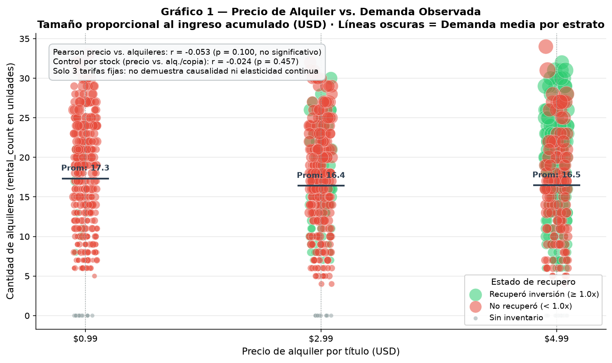
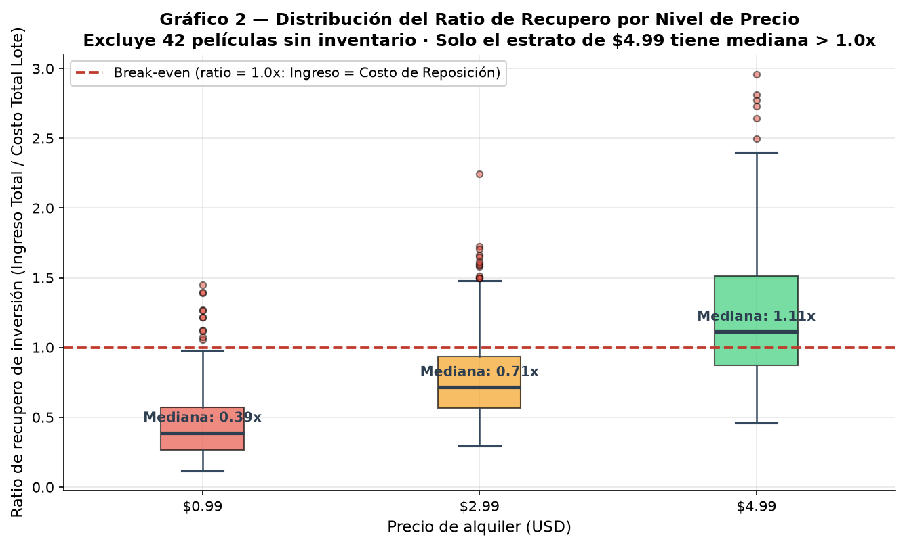
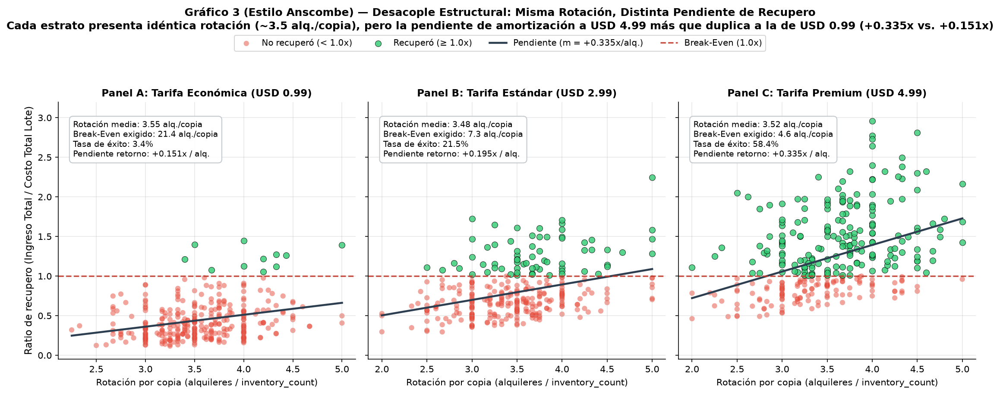

# Informe Final de Conclusiones — Trabajo Práctico 2
**Materia:** Seminario de Actualización | **Docente:** Jorge Insfran  
**Equipo:** 6 | **Integrantes:** Agustín Bugnoni, Lorenzo Zárate  
**Variante:** 6 — Precios, recupero y rentabilidad del catálogo  

---

## 1. Pregunta de Negocio y Abordaje Metodológico

### Pregunta de Negocio Asignada
> *¿Cada película recupera lo que costó reponerla? ¿El precio de alquiler tiene relación con la demanda?*

### Abordaje Metodológico
Para responder a esta problemática, estructuramos un flujo de trabajo reproducible entre **Microsoft SQL Server** y **Python (SQLAlchemy, pyodbc, Pandas, NumPy, Matplotlib, Seaborn)**, organizado en tres ejes:

1. **Relación Precio–Demanda (comparación por estratos):** Contrastamos la tarifa unitaria de alquiler (`rental_rate`) contra la rotación acumulada (`rental_count`) y contra la rotación normalizada por stock (`alquileres_por_copia`) mediante correlación de Pearson y diagramas de dispersión con *jitter* ponderados por facturación acumulada (`total_revenue`).
2. **Análisis Financiero de Recupero y Break-Even por Lote:** Evaluamos la amortización a nivel título contrastando ingresos brutos contra el costo total de reposición del lote físico:
   $$\text{costo\_total} = \text{inventory\_count} \times \text{replacement\_cost} \quad\Big|\quad \text{ratio\_recupero} = \frac{\text{total\_revenue}}{\text{costo\_total}}$$
   Fijamos el umbral de equilibrio en $1.0\times$ (amortización completa) y calculamos la rotación mínima por copia: $\text{breakeven\_alquileres} = \lceil \frac{\text{replacement\_cost}}{\text{rental\_rate}} \rceil$.
3. **Cobertura de Inventario:** Cuantificamos los títulos del catálogo sin stock físico registrado (`inventory_count = 0`) sin proyectar demanda inobservada.

---

## 2. Decisiones de Diseño Técnico

### 2.1 Reparto de Cómputo entre SQL Server y Python
* **En el Motor de Base de Datos (SQL Server):**
  * **Resolución relacional y agregación en origen:** Procesamiento de la cadena `pelicula` $\rightarrow$ `inventario` $\rightarrow$ `alquiler` $\rightarrow$ `pago` con `LEFT JOIN` para preservar las 1.000 películas del catálogo (incluidas las 42 sin copias físicas) y `COUNT(DISTINCT id_alquiler)` para evitar duplicaciones si un alquiler tuviera múltiples pagos. Reduce la transferencia de red de más de 32.000 filas transaccionales a 1.000 filas agregadas.
  * **Benchmark verificado (mediana de 5 ejecuciones):** El cálculo de ingresos por película resultó **3.07x más rápido en T-SQL** (`0.0139 s`) que descargando tablas crudas en Pandas (`0.0426 s`), con diferencia numérica máxima de `0.000000`.
* **En el Cliente de Análisis (Python / Pandas):**
  * **Cálculo vectorizado:** Primitivas de NumPy (`np.where`, `np.select`, `np.ceil`) en complejidad $O(N)$, sin bucles ni `iterrows()`.
  * **Casos de borde e integración:** Manejo sin divisiones por cero para títulos con `inventory_count = 0` y fusión controlada (`pd.merge(..., validate="many_to_one", indicator=True)`) con `clasificacion_tarifaria.csv`.

### 2.2 Elección del Controlador de Conexión (`SQLAlchemy` + `pyodbc`)
En [config_conexion.py](../config_conexion.py) combinamos **SQLAlchemy** (capa de `Engine`, transacciones explícitas y compatibilidad con `pandas.read_sql`) con el controlador ODBC **`pyodbc`** (elegido frente a `mssql-python`) por tres razones operativas:
1. **Madurez y compatibilidad oficial:** Amplia integración con *Microsoft ODBC Driver 18 for SQL Server* tanto en Linux como en Windows (soportando autenticación SQL o integrada de Windows vía `.env`).
2. **Carga masiva eficiente:** Soporte nativo para `fast_executemany=True` en SQLAlchemy, optimizando inserciones por lotes en la etapa ETL.
3. **Precisión verificada:** En SQL Server los montos se almacenan con precisión fija (`DECIMAL(4,2)` y `DECIMAL(5,2)`). Al leerlos en Pandas vía `pd.read_sql`, los importes se materializan como **`float64`** (no como objetos `Decimal`); la reconciliación contra T-SQL verificó coincidencia exacta (`0.000000` de diferencia máxima).

### 2.3 Desacoplamiento de Esquema, Portabilidad y Parametrización (`esquema.py` + `sql/` + `params`)
* **Único punto de configuración:** [esquema.py](../esquema.py) centraliza el esquema SQL Server (`"schema": "dbo"`), las tablas y las columnas. Las funciones `t()`, `c()` y `fqn()` validan los identificadores y **fallan explícitamente (`KeyError`)** si falta una clave, evitando errores silenciosos al cambiar de base.
* **Scripts SQL portables:** [sql/conjunto_trabajo.sql](../sql/conjunto_trabajo.sql) y [sql/reconciliacion.sql](../sql/reconciliacion.sql) no contienen `USE [...]` ni nombres en español hardcodeados. `conjunto_trabajo.sql` se renderiza desde `esquema.py` y **todos los valores variables de filtrado** (`tarifa_min`, `tarifa_max`, `clasificacion`) viajan estrictamente mediante el argumento **`params`** de `pd.read_sql` / `pd.read_sql_query` (tanto en el notebook —incluyendo una demostración filtrada por `PG-13` y rango `[2.99, 4.99]`— como en el pipeline).
* **Reconciliación dinámica sin cifras escritas a mano:** `esquema.reconciliar_con_origen()` cuenta filas directamente desde el volcado de origen (`sakila-dataSQLserver.sql`) y desde `sys.tables`/`sys.partitions` en SQL Server (`params={"esquema": esquema.schema()}`), confirmando **diferencia = 0 en las 15 tablas** (incluida `payment`: **16.044 vs. 16.044**; el ID máximo `16.049` responde a 5 huecos de secuencia, no a filas perdidas, y `id_alquiler` admite `NULL` en `sakila-schemaSQLserver.sql` con 0 pagos nulos en el volcado).

### 2.4 Criterios de Calidad y Carga Transaccional Idempotente
* **Validación previa (*Fail-Fast*):** `validar_calidad()` audita estructura, unicidad de `film_id`, nulos y rangos antes de transformar.
* **Idempotencia transaccional:** En [pipeline/pipeline_tp2.py](../pipeline/pipeline_tp2.py), la carga ocurre dentro de `with engine.begin() as connection:` (transacción explícita): crea `TP2_RecuperoPorPelicula` con `PRIMARY KEY (film_id)` si no existe, valida el esquema existente, ejecuta `DELETE` + `to_sql(..., if_exists="append")` y verifica poscarga `COUNT(*) = 1000` y `COUNT(DISTINCT film_id) = 1000`. Ante cualquier error revierte (`ROLLBACK`) y relanza la excepción.

---

## 3. Síntesis del Diagnóstico de Calidad de Datos

Evaluamos las seis dimensiones formales de calidad sobre el conjunto de trabajo (1.000 películas) y las tablas transaccionales de origen:

| Dimensión | Evaluación en los Datos | Impacto Metodológico |
| :--- | :--- | :--- |
| **Completitud** | 0 nulos en las 9 columnas del conjunto de trabajo (`LEFT JOIN` + `ISNULL`). | 183 alquileres abiertos tienen `return_date IS NULL` (esperado). |
| **Unicidad** | 1.000 registros únicos sobre `film_id`. | Cobertura biunívoca del catálogo completo. |
| **Validez** | 0 violaciones en 3 reglas independientes: `replacement_cost > rental_rate`, `return_date >= rental_date` y `payment_date >= rental_date`. | Integridad lógica verificada en catálogo y transacciones. |
| **Consistencia** | `rating` normalizado en 5 categorías canónicas (`G`, `PG`, `PG-13`, `R`, `NC-17`). | Sin necesidad de limpieza de cadenas. |
| **Exactitud** | Reconciliación 15/15 tablas con diferencia = 0; réplica T-SQL vs. Pandas 100% exacta. | Sin pérdida ni distorsión en la migración ni en la extracción. |
| **Oportunidad** | **Histórico cerrado y discontinuo (2005–2006):** actividad en mayo–agosto 2005, **5 meses enteros sin movimientos** (sep 2005–ene 2006) y 182 registros el 14/02/2006. | Apto para medir recupero acumulado en el período observado; **no** apto para estacionalidad continua ni proyecciones vigentes. |

### Hallazgo Crítico de Calidad: Solo 3 Precios Discretos y Tratamiento de Outliers
* **Cardinalidad de `rental_rate` = 3:** **\$0.99 (34.1%)**, **\$2.99 (32.3%)** y **\$4.99 (33.6%)**. Esto **invalida estimar curvas de demanda continuas** o elasticidades puntuales ($\frac{\%\Delta Q}{\%\Delta P}$), limitando el análisis a la comparación descriptiva de tres estratos fijos.
* **Outliers de `total_revenue` (Tukey IQR):** $Q_1 = \$33.95$, Mediana $= \$61.85$, $Q_3 = \$93.09$, $IQR = \$59.14$, límite superior $= \$181.80$. Se detectaron **11 títulos superiores** (máximo: *TELEGRAPH VOYAGE*, \$231.73). **Se conservan todos** porque representan éxitos comerciales legítimos (*blockbusters*), y se preservan las **42 películas con \$0.00** etiquetadas como `"Sin inventario"`.

---

## 4. Hallazgos Narrativos y Toma de Decisiones

### Hallazgo 1 — Ausencia de correlación observada entre tarifa y rotación (no equivale a inelasticidad causal)

* **Observación:** Sobre las 958 películas con stock, los tres estratos muestran promedios de alquileres casi idénticos ($\bar{Q}_{\$0.99} = 17.3$, $\bar{Q}_{\$2.99} = 16.4$, $\bar{Q}_{\$4.99} = 16.5$) con correlación lineal nula ($r = -0.053, p = 0.100 > 0.05$). Más aún, una variable presente en los propios datos —la cantidad de copias (`inventory_count`)— explica por sí sola ~86.4% de la varianza de `rental_count` ($r = 0.929$). Al controlar por copias mediante **`alquileres_por_copia`**, los tres estratos siguen prácticamente igualados (**3.55**, **3.48** y **3.52** alq./copia; $r = -0.024, p = 0.457$).
* **Explicación y límite causal:** Una correlación nula entre 3 tarifas fijas en un corte transversal **no demuestra inelasticidad perfecta ni que el precio carezca de efecto causal**: nunca se observó cambiar el precio de un mismo título, y variables omitidas (popularidad, género, elenco o criterio de asignación comercial) pueden confundir la relación.
* **Decisión comercial:** **No eliminar unilateralmente la tarifa de \$0.99.** En su lugar, **ejecutar un experimento controlado (prueba piloto A/B)** migrando una muestra estratificada de títulos de \$0.99 a \$2.99 (controlando por género, clasificación y cantidad de copias) para medir empíricamente si la rotación cae antes de modificar el tarifario general.

---

### Hallazgo 2 — Brecha estructural de recupero entre estratos bajo la estructura vigente

* **Observación (Boxplot):** Con stock disponible, el ratio de recupero diverge marcadamente por estrato:
  * **\$4.99 (Premium):** mediana **`1.11x`** ($Q_1 = 0.87\times, Q_3 = 1.51\times$); el **58.4%** supera el punto de equilibrio ($\ge 1.0\times$).
  * **\$2.99 (Estándar):** mediana **`0.71x`** ($Q_1 = 0.57\times, Q_3 = 0.94\times$); el **21.5%** alcanza el equilibrio.
  * **\$0.99 (Económico):** mediana **`0.39x`** ($Q_1 = 0.27\times, Q_3 = 0.57\times$); apenas el **3.4%** logra amortizar su lote.

* **Observación (Panel estilo Anscombe):** Con rotaciones por copia similares (~3.5 alq./copia), cada alquiler a **\$4.99** aporta **`+0.335x`** de recupero (break-even promedio: 4.6 alq./copia), más del doble que a **\$0.99** (**`+0.151x`**, break-even exigido: 21.4 alq./copia).
* **Explicación económica (en coherencia con el Anexo de IA):** Como el costo de reposición es homogéneo entre estratos (~\$20 por copia), la tarifa de \$0.99 exige multiplicar por ~6 veces la rotación típica para equilibrar el lote. No obstante, por sesgo de variable omitida (Caso 2 del Anexo de IA), no puede asumirse que subir el precio de un título de \$0.99 a \$4.99 mantendría intacta su rotación.
* **Decisión comercial:** **Detener compras automáticas de nuevas copias para títulos de \$0.99 con bajo recupero** y auditar los criterios de reposición y asignación tarifaria (costo de reposición, cantidad de copias iniciales y desempeño por género) antes de comprometer capital en ese estrato.

---

### Hallazgo 3 — El 4.2% del catálogo carece de inventario y no posee demanda observada
* **Observación:** Existen **42 títulos en catálogo con `inventory_count = 0`**, acumulando \$0.00 de facturación.
* **Explicación:** Su recaudación nula responde a la ausencia total de copias físicas disponibles en tienda. Sin embargo, precisamente porque nunca estuvieron en estantería, **no existen datos históricos que permitan estimar cuántos alquileres ni qué ingresos generarían**.
* **Decisión comercial:** **Implementar un piloto acotado de stock mínimo (1 a 2 copias)** sobre un subconjunto priorizado de estos 42 títulos (según categorías y clasificaciones con mejor rotación observada) para recabar demanda real antes de evaluar compras de lotes completos.

---

## 5. Limitaciones del Análisis

1. **Imposibilidad de inferencia continua:** Con solo 3 precios discretos (\$0.99, \$2.99, \$4.99) no es válido estimar curvas de demanda continuas ni extrapolar a precios intermedios o superiores.
2. **Correlación no es causalidad y sesgo de variable omitida (*Omitted Variable Bias*):** El análisis es observacional y transversal. Aunque controlamos `inventory_count` mediante `alquileres_por_copia`, variables no observadas (popularidad, elenco, género, ubicación física y criterio original de fijación de precios) impiden atribuir causalidad al precio.
3. **Cobertura temporal discontinua e histórica:** La base corresponde a 2005–2006 y presenta 5 meses completos sin actividad (septiembre 2005 a enero 2006), lo que restringe la interpretación al acumulado histórico del período registrado.
4. **Margen bruto sobre reposición:** El ratio de recupero contrasta ingresos brutos contra `replacement_cost` sin descontar costos operativos (personal, alquiler de locales, deterioro). Mide amortización del activo físico, no utilidad neta.

---

## 6. Dificultades Técnicas y Soluciones Implementadas

1. **Dependencias ODBC en entornos heterogéneos (Linux/Windows):** En Linux `pyodbc` fallaba sin `unixodbc`. Se documentó la instalación de `unixodbc` y *Microsoft ODBC Driver 18* en [README.md](../README.md) y se configuró `TrustServerCertificate=yes` mediante `.env` (manteniendo transacciones explícitas en SQLAlchemy vía `engine.begin()`).
2. **Reconciliación de pagos y conteo del origen:** Inicialmente se había consignado `16.049` como cantidad de pagos en origen y atribuido la diferencia a `id_alquiler NOT NULL`. Al auditar [sakila-schemaSQLserver.sql](../sakila-schemaSQLserver.sql) y [sakila-dataSQLserver.sql](../sakila-dataSQLserver.sql) se comprobó que `id_alquiler` admite `NULL`, que `16.049` es el `MAX(id_pago)` (con 5 huecos de secuencia) y que el volcado tiene exactamente `16.044` filas. Se reemplazó el conteo manual por lectura programática del volcado y consulta dinámica sobre `sys.tables`/`sys.partitions`.
3. **Divisiones por cero en títulos sin stock:** Las 42 películas con `inventory_count = 0` se resolvieron con lógica vectorizada (`np.where`), evitando `inf`/`NaN` y conservando el 100% del catálogo.
4. **Portabilidad real entre bases de distintos equipos:** Se eliminaron nombres en español y `USE [...]` de `sql/`, se incorporó el calificador de esquema (`schema`) en `esquema.py` con fallo explícito (`KeyError`) ante claves faltantes y se pasaron los filtros reales vía `params`.
5. **Idempotencia transaccional:** Se implementó `DELETE` + `to_sql(..., if_exists="append")` dentro de `with engine.begin()`, verificando poscarga `COUNT(*) = 1000` y `COUNT(DISTINCT film_id) = 1000` en ejecuciones consecutivas.

---
**Equipo 6 — Seminario de Actualización 2026**  
Agustín Bugnoni — Lorenzo Zárate
