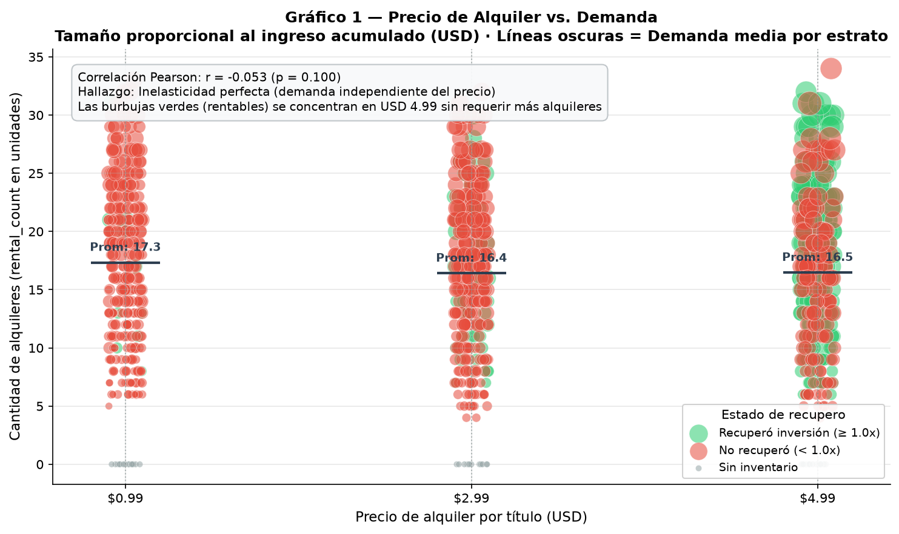
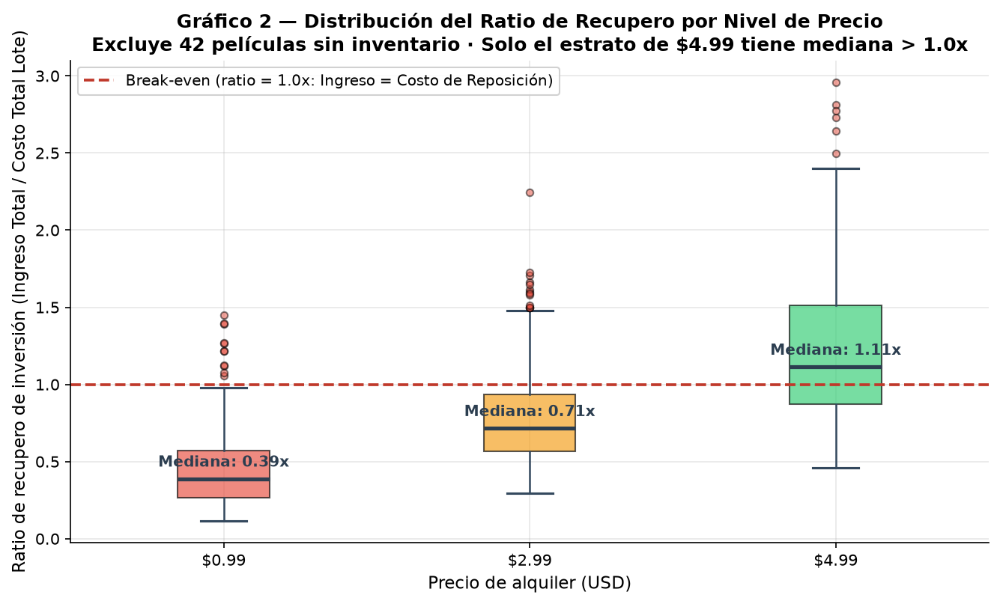
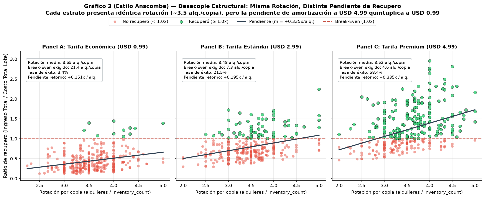

# Informe Final de Conclusiones — Trabajo Práctico 2
**Materia:** Seminario de Actualización | **Docente:** Jorge Insfran  
**Equipo:** 6 | **Integrantes:** Agustin Bugnoni, Lorenzo Zárate  
**Variante:** 6 — Precios, recupero y rentabilidad del catálogo  

---

## 1. Pregunta de Negocio y Abordaje Metodológico

### Pregunta de Negocio Asignada
> *¿Cada película recupera lo que costó reponerla? ¿El precio de alquiler tiene relación con la demanda?*

### Abordaje Metodológico
Para responder a esta problemática, estructuramos un flujo de trabajo entre **Microsoft SQL Server** y **Python (Pandas, NumPy, Matplotlib, Seaborn)**, dividido en tres ejes analíticos:

1. **Sensibilidad y Elasticidad Precio-Demanda:** Contrastamos la tarifa unitaria de alquiler (`rental_rate`) contra el volumen físico de rotación (`rental_count`) mediante correlaciones lineales (Pearson, Spearman) y diagramas de dispersión ponderados por facturación acumulada (`total_revenue`).
2. **Análisis Financiero de Recupero y Break-Even por Lote:** Modelamos la amortización a nivel título contrastando ingresos brutos contra el costo total de adquisición del lote físico:
   $$\text{costo\_total} = \text{inventory\_count} \times \text{replacement\_cost} \quad\Big|\quad \text{ratio\_recupero} = \frac{\text{total\_revenue}}{\text{costo\_total}}$$
   Fijamos el umbral de equilibrio en $1.0\times$ (amortización completa) y calculamos la rotación mínima exigida: $\text{breakeven\_alquileres} = \lceil \frac{\text{replacement\_cost}}{\text{rental\_rate}} \rceil$.
3. **Costo de Oportunidad y Eficiencia de Inventario:** Cuantificamos el impacto económico de los títulos catalogados desprovistos de stock físico (`inventory_count = 0`).

---

## 2. Decisiones de Diseño Técnico

### 2.1 Reparto de Cómputo entre SQL Server y Python
Delimitamos la arquitectura distribuyendo la carga de procesamiento según la especialización de cada capa:

* **En el Motor de Base de Datos (SQL Server):**
  * **Resolución relacional pesada:** Procesamiento de la cadena `pelicula` $\rightarrow$ `inventario` $\rightarrow$ `alquiler` $\rightarrow$ `pago` optimizada por índices agrupados.
  * **Preservación exhaustiva del catálogo (`LEFT JOIN`):** Se descartó terminantemente el uso de `INNER JOIN`. En Sakila, 42 películas no poseen copias registradas; un `INNER JOIN` las habría eliminado silenciosamente. El `LEFT JOIN` preserva el universo íntegro de 1.000 títulos.
  * **Agregaciones en origen:** Computación directa de `COUNT(DISTINCT inventory_id)`, `COUNT(rental_id)` y `ISNULL(SUM(amount), 0.0)`, reduciendo la transferencia de red de más de 32.000 transacciones crudas a un dataset agregado de 1.000 registros.
* **En el Cliente de Análisis (Python / Pandas):**
  * **Cálculo vectorizado de ratios:** Implementación con primitivas de NumPy (`np.where`, `np.select`, `np.ceil`), asegurando complejidad temporal $O(N)$ y descartando bucles `iterrows()` por ineficiencia de memoria.
  * **Manejo defensivo de casos de borde:** Tratamiento condicional para títulos sin copias (`inventory_count = 0`), asignando ratios de recupero en $0.00$ sin generar excepciones de división por cero.
  * **Enriquecimiento multi-origen:** Fusión controlada (`pd.merge`) con datos planos complementarios de clasificación comercial.

### 2.2 Elección del Controlador de Conexión (`pyodbc`)
Adoptamos **`pyodbc`** sobre SQLAlchemy por tres ventajas operativas:
1. **Fidelidad estricta de tipos:** Interacción nativa con *Microsoft ODBC Driver 18*, asegurando serialización exacta de tipos migrados (`DECIMAL(5,2)` monetario de punto fijo y `DATETIME2`), evitando divergencias de redondeo propias del punto flotante en cálculos contables.
2. **Inserción masiva de alto rendimiento:** Soporte nativo para el parámetro `fast_executemany=True` en SQLAlchemy, reduciendo los tiempos de carga en la etapa ETL.
3. **Seguridad y parametrización:** Conexión desacoplada mediante variables de entorno locales protegidas (`.env`), eliminando credenciales expuestas en el repositorio.

### 2.3 Desacoplamiento de Esquema y Portabilidad (`esquema.py`)
Para independizar la lógica de extracción del esquema físico de tablas y columnas (renombradas al español en el TP1), diseñamos `esquema.py` como una capa de abstracción de metadatos. El módulo provee un diccionario bidireccional y la función constructora `generar_query_conjunto_trabajo()`, resolviendo los identificadores de la consulta en tiempo de ejecución. Esta arquitectura garantiza independencia del modelo físico subyacente y permite ejecutar el pipeline sobre esquemas con distinta convención de nombres sin modificar la lógica analítica. Los parámetros de filtrado dinámico se inyectan estrictamente mediante el argumento `params` de `pd.read_sql`, previniendo inyecciones SQL.

### 2.4 Criterios de Calidad y Carga Transaccional Idempotente
* **Validación previa (Fail-Fast):** La función `validar_calidad()` audita aserciones críticas (no vacíos, unicidad de claves, tarifas positivas y rangos válidos) antes de iniciar las transformaciones.
* **Idempotencia transaccional (Truncate-and-Load):** En `pipeline/pipeline_tp2.py`, la carga se ejecuta dentro del contexto transaccional `with engine.begin() as connection:`. Previo al `to_sql(..., if_exists='append')`, se ejecuta un `DELETE` controlado sobre `dbo.TP2_RecuperoPorPelicula`. Si ocurre una falla a mitad del proceso, la transacción realiza un `ROLLBACK` automático, impidiendo estados corruptos o inconsistentes. Dos o más ejecuciones sucesivas dejan exactamente 1.000 registros verificados con aserciones poscarga de `COUNT` total y `COUNT DISTINCT`.

---

## 3. Síntesis del Diagnóstico de Calidad de Datos

Evaluamos las seis dimensiones formales de calidad sobre el conjunto de trabajo (1.000 películas):

| Dimensión | Evaluación en el Dataset | Impacto Metodológico |
| :--- | :--- | :--- |
| **Completitud** | 100% completo (0 nulos en las 9 columnas). | Ausencias transaccionales absorbidas en origen con `ISNULL(..., 0.0)`. |
| **Unicidad** | 1.000 registros únicos sobre la clave `film_id`. | Cobertura exacta y biunívoca del catálogo catalogado. |
| **Validez** | 100% cumplimiento de reglas: `rental_rate > 0`, `replacement_cost > rental_rate`. | Datos coherentes con las restricciones lógicas del dominio. |
| **Consistencia** | Variable categórica `rating` con exactamente 5 categorías canónicas. | Sin anomalías ortográficas ni necesidad de normalización de strings. |
| **Exactitud** | Reconciliación matemática plena entre agregaciones en SQL Server y Pandas. | Consistencia numérica absoluta en ingresos y rotaciones. |
| **Oportunidad** | Cobertura temporal histórica consolidada del videoclub. | Datos aptos para determinar la amortización acumulada de activos. |

### Hallazgo Crítico de Calidad: Cardinalidad Discreta de Precios
La variable `rental_rate` asume exclusivamente **3 valores discretos**: **\$0.99 (34.1%)**, **\$2.99 (32.3%)** y **\$4.99 (33.6%)**.  
*Impacto en el análisis:* **Invalida el ajuste de curvas de demanda continuas** y el cálculo de elasticidades puntuales ($\frac{\%\Delta Q}{\%\Delta P}$). La distribución uniforme obliga a estructurar las conclusiones como una **comparación inter-estratos discretos**.

### Tratamiento Justificado de Outliers (Regla IQR de Tukey sobre Ingresos)
Se detectaron 11 películas con ingresos superiores al umbral de Tukey (\$181.80), lideradas por *TELEGRAPH VOYAGE* (\$231.73).  
*Criterio adoptado:* **Se conservan en su totalidad.** En analítica de negocios, los outliers superiores representan títulos *blockbuster* de rotación legítima. Eliminarlos introduciría un sesgo de supervivencia y subestimaría la rentabilidad real. Asimismo, las 42 películas con facturación \$0.00 se preservaron bajo la etiqueta *"Sin inventario"*.

---

## 4. Hallazgos Narrativos y Toma de Decisiones

### Hallazgo 1 — Inelasticidad de Demanda: El precio unitario no condiciona el volumen

* **Observación:** Los tres estratos de precio presentan promedios y dispersiones de rotación física casi idénticos:
  $$\bar{Q}_{\$0.99} = 17.3 \text{ alquileres} \quad|\quad \bar{Q}_{\$2.99} = 16.4 \text{ alquileres} \quad|\quad \bar{Q}_{\$4.99} = 16.5 \text{ alquileres}$$
  La correlación lineal de Pearson es estadísticamente nula: $r = -0.053$ ($p = 0.100 > 0.05$).
* **Explicación:** La demanda es inelástica en el rango de \$0.99 a \$4.99. La decisión de alquiler está regida por factores no tarifarios (género, actores, exhibición o disponibilidad). El cliente no incrementa su consumo por una tarifa de \$0.99 ni se inhibe de alquilar ante un precio de \$4.99.
* **Decisión comercial:** **Eliminar la tarifa piso de \$0.99 y migrar el catálogo hacia \$2.99 y \$4.99.** Dado que la demanda no se contrae con el precio, la migración incrementa los ingresos brutos de forma directa.

---

### Hallazgo 2 — El precio determina la velocidad de amortización, no la demanda

* **Distribución del recupero por tarifa:** El boxplot evidencia una asimetría estructural severa. A **\$4.99**, el **58.4%** de los títulos supera el umbral de break-even (ratio $\ge 1.0\times$) con una mediana de $1.15\times$. Por el contrario, a **\$0.99**, la tasa de éxito colapsa al **3.4%** y la mediana se sitúa en un deficitario $0.46\times$.

* **Pendientes de amortización (Anscombe):** Pese a registrar una rotación promedio similar (~3.5 alquileres por copia), la eficiencia marginal diverge: cada alquiler a **\$4.99** incrementa el recupero en **$+0.335\times$** (break-even en 4.6 alquileres/copia), mientras que a **\$0.99** la pendiente es de apenas **$+0.151\times$** y la exigencia asciende a 21.4 alquileres/copia.
* **Explicación económica:** El costo de reposición es homogéneo en todo el catálogo (~$20 por título), independientemente del precio de alquiler. Fijar \$0.99 impone una exigencia física de rotación que excede la vida útil del soporte antes de su desgaste material.
* **Decisión comercial:** **Congelar compras de copias para títulos de \$0.99.** Toda inversión en nuevo inventario debe concentrarse en títulos tarifados a \$2.99 y \$4.99 para asegurar la amortización del capital.

---

### Hallazgo 3 — El 4.2% del catálogo sin stock constituye un costo de oportunidad directo
* **Observación:** Existen **42 títulos en catálogo con 0 copias en inventario**, acumulando \$0.00 de facturación.
* **Explicación:** Su facturación nula no refleja rechazo del público ni obsolescencia, sino un quiebre de stock en origen: nunca estuvieron físicamente disponibles en sucursal.
* **Decisión comercial:** **Incorporar un lote inicial de 3 a 4 copias para estos 42 títulos bajo tarifa de \$4.99.** Ante la inelasticidad comprobada, generarán un ingreso estimado de ~$60–$70 por película, amortizándose en menos de 5 transacciones por copia.

---

## 5. Limitaciones del Análisis

Como en todo análisis empírico sobre modelos transaccionales relacionales, identificamos cuatro restricciones metodológicas:

1. **Imposibilidad de inferencia continua:** Al existir sólo 3 precios discretos, es metodológicamente inválido proyectar curvas continuas o estimar la respuesta del mercado ante tarifas intermedias (\$1.99, \$3.49) o superiores (\$6.99).
2. **Sesgo de variable omitida (*Omitted Variable Bias*):** El modelo no captura variables de preferencia (género, elenco, campañas publicitarias o ubicación en tienda). Por ende, el precio no puede interpretarse como causa aislada de la demanda.
3. **Margen de amortización bruto:** El cálculo considera el costo de reposición (`replacement_cost`), omitiendo costos operativos (almacenamiento, personal, deterioro físico). Representa amortización de activo, no beneficio contable neto.
4. **Corte transversal estático:** El análisis consolida el histórico transaccional acumulado sin distinguir estacionalidad ni efectos de canibalización temporal.

---

## 6. Dificultades Técnicas y Soluciones Implementadas

1. **Enlace dinámico ODBC en entornos heterogéneos (Linux/Windows):**
   * *Problema:* En Linux, `pyodbc` fallaba por ausencia de dependencias de `unixodbc`.
   * *Solución:* Se estandarizó el entorno documentando la instalación de librerías nativas y configurando la conexión con `TrustServerCertificate=yes` y `autocommit=True`.
2. **Indeterminaciones por títulos sin inventario:**
   * *Problema:* Las 42 películas sin copias generaban divisiones por cero (`ZeroDivisionError` / `inf`) al computar métricas por copia.
   * *Solución:* Implementamos lógica condicional vectorizada con `np.where(inventory_count > 0, ..., 0.0)`, preservando la integridad del catálogo bajo la categoría *"Sin inventario"*.
3. **Idempotencia y atomicidad en la carga masiva:**
   * *Problema:* `TRUNCATE TABLE` generaba bloqueos por dependencias foráneas, mientras que cargas repetidas duplicaban filas.
   * *Solución:* Implementamos una transacción atómica con `DELETE` previo e inserción masiva (`to_sql`), auditada por aserciones poscarga de conteo y unicidad.
4. **Desacoplamiento de identificadores físicos:**
   * *Problema:* Hardcodear nombres traducidos al español acoplaba el código a una base específica.
   * *Solución:* Aislamos los nombres en el módulo `esquema.py` y parametrizamos dinámicamente las consultas SQL.

---
**Equipo 6 — Seminario de Actualización 2026**  
Agustin Bugnoni — Lorenzo Zárate
